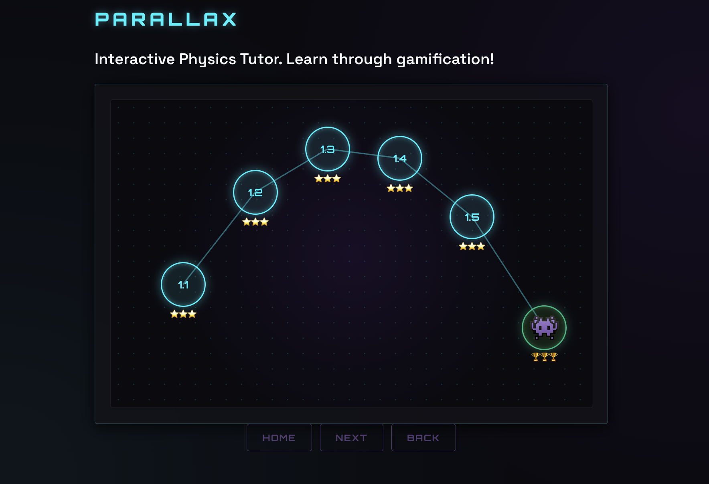
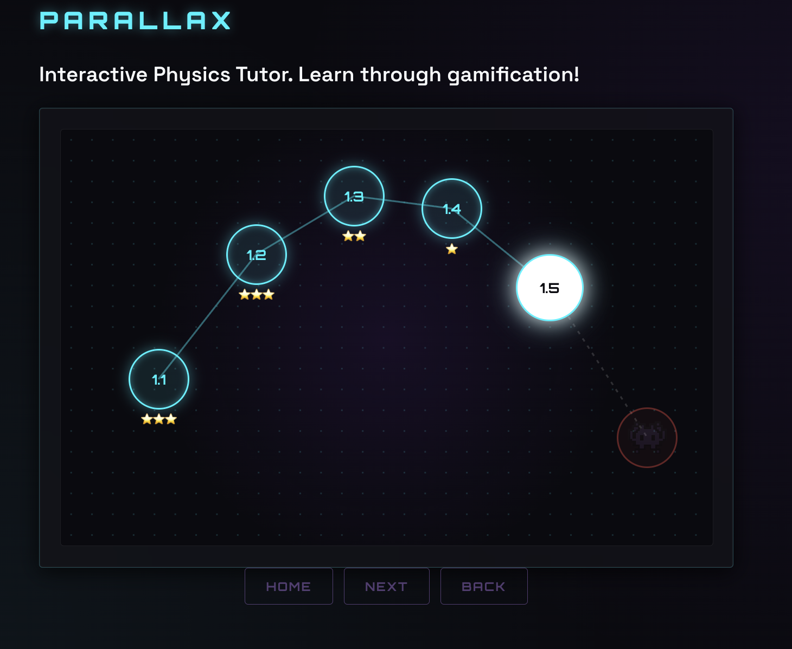
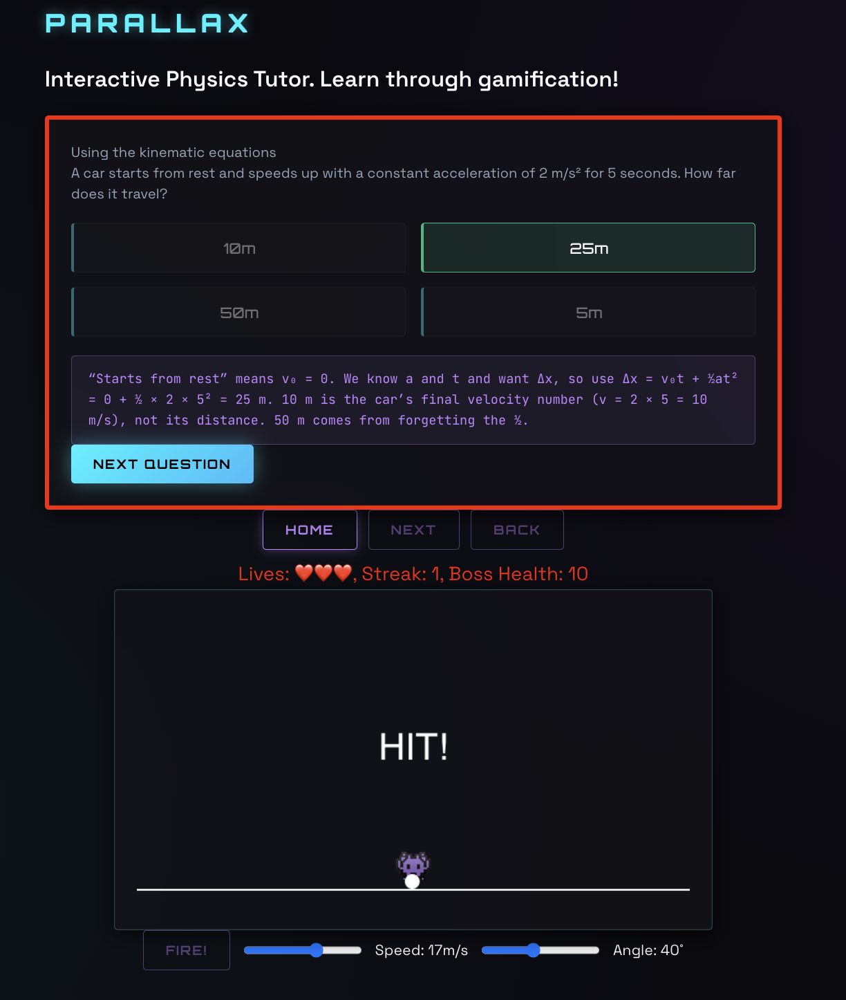
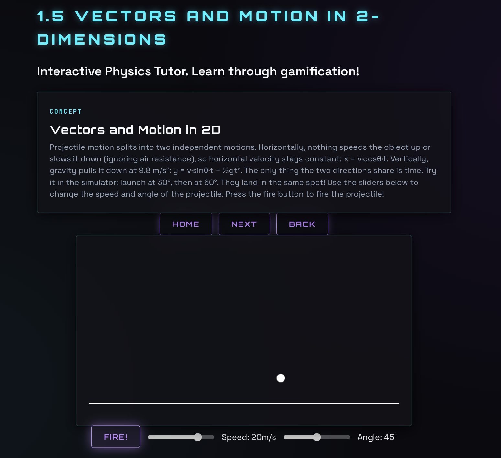

# Parallax Physics Tutor

## Background Context
### Why I created Parallax
Parallax is a physics tutor created for students interested in learning the AP Physics 1 curriculum. I want to take AP Physics C in high school. One of the best ways to prepare for the class is through AP Physics 1. However, most online courses and textbooks are extremely passive ways to learn. I decided to gamify the AP Physics 1 content and make physics seem like a great science class that fosters academic growth and critical thinking. To gamify the app, I included a simulator for projectile motion and a boss battle at the end of the unit. The boss battle uses the simulator to assess a student's understanding of physics through questions and a game that literally uses physics. 

### How it Works!
Parallax starts on a home page galaxy. This galaxy is already set to Unit 1 as default. There are 5 lessons and 1 boss in the Unit 1 galaxy, and each lesson unlocks the next one. You can press the lesson button to start the lesson, then go through each of the concept cards in a lesson. Every lesson has a hook card, concept card, some check questions, and then a summary at the end. Depending on the number of mistakes you make during the check questions, you earn your score in terms of stars. (It's physics, it has to be about space!). Then, the next lesson will be unlocked when you cycle back to the home page.

After you complete all the lessons in order, the boss battle will be unlocked. This is the final stage which will decide if you can move onto the next unit (in the future; currently, there is only one unit). After you defeat the boss, you are done with Parallax (for now).

Sidenote: The boss is very difficult, even if you get the questions correct, calculating the range of the projectile in the simulator is very difficult to actually hit the boss.

Try out the app here: https://parallax-physics.vercel.app/

Watch a LIVE DEMO of Parallax in action!: 

## Here is a summary of all the features of Parallax:
1. The Galaxy map - the idea for the galaxy came from the spacey-vibe of physics. The galaxy is a div element in HTML which holds the lesson buttons. The lines connecting the lessons are SVG. This follows how constellations have recognizable shapes in real life. The lesson galaxy holds the lessons in a constellation! The galaxy for unit 1 is shaped in a parabolic path because the motion of projectile motion is a parabolic path.
2. Projectile motion simulator - There is one simulator in Parallax and it has found a home in lesson 1.5, projectile motion. The canvas element holds the simulator used in the boss battle and lesson 1.5. This simulator takes in an angle and speed for the projectile as an input. The user can use the provided sliders to adjust the speed and angle of the projectile. The "fire" button fires the projectile and shows a simulation of a projectile flying through the air (neglecting air resistance). 

A cool fact for this simulator is that its code uses the kinematic equations to actually find the true x and y value the projectile should be displayed/drawn at.

3. Boss battle - Every Unit ends in a boss battle. The boss battles will each use one simulator from their unit to defeat the boss in some way. In unit 1, it uses the projectile motion simulator to hit the boss with the projectile. Boss battles will call random questions from the check questions from all the lessons in the unit. After you answer, you will then be given the opportunity to play the game to try and defeat the boss.

## The tools used:
- Languages: HTML, CSS, and JavaScript. These are basic frontend developing tools used for the coding aspect of the project.
- Browser tools: Canvas API, SVG, and localStorage - These are the special tools that are used in the app. The Canvas is used for the simulator and the SVG is used to make lines in the galaxy. The localStorage stores a user's progress on their local browser on their device.
- IDE: VS Code, Live Server - I used VS code as the main IDE to code this project. VS code also has a "live server" feature, which allows testing of an app without actually using a hosting platform.
- Hosting platform: Vercel - I used Vercel to publish my app for anyone to use, including you! Vercel gives a free domain for the app to run.
- Repository: GitHub - I store all of the code to the project publicly on github. Feel free to check any of the other files to see the inner-workings of Parallax. Some things I would recommend are the simulator code and boss battle code.

## Here is my journey (The DEVLOG has more info):
I first started this project to learn React, a more advanced and modernly used library in web development. As seen in my DEVLOG, I spent around 5 days learning React from the ground up. I made it as far as the tic-tac-toe tutorial on react's "quick start" page. 

However, I decided to continue with JavaScript and HTML, because they are easier coding languages and could guarantee the creation of an app in a short time. Additionally, there was still a learning curve with JavaScript and HTML because I had never draw things on screen or coded from scratch before, especially in the web development field. 

I started by creating the first lesson, including 4 cards (hook, concept, check, summary). This helped me get started with coding apps from scratch. I learned about basic syntax. Since I came from a background with python and java, even the basics like creating variables with the keyword "let" and "const" were unusual.

Then, I transitioned to creating buttons with event listeners to go through the lessons and return home. This sounds simple, but it took multiple days. I coded multiple functions, including showAnswered(), and I added classes from the CSS file to the lesson checks. I was able to deploy for the first time to Vercel.

Next, I created the simulator. I started by creating the drawFrame() function, which was the hardest part because it tested my physics knowledge and it required learning how to both draw on canvas and repeatedly call a function (requestAnimationFrame).

Finally, I had the idea for the boss battle. I incorporated both the simulator I created and lesson questions. The boss battle includes everything + the boss icon and a few more elements to display the player's lives and boss health. I additionally added end screens for a defeat and victory. Finally, I added trophies to make it look more like a game from the home galaxy.

## Biggest challenge
The hardest part of my app was the simulator. The steep learning curve took time to handle and multiple bugs popped up. To make the simulator work, I needed to make a projectile move along a path, but with code. 

At first, I used a for-loop to adjust the ball. However, I neglected the fact that a for-loop completely runs at once, in milliseconds. In reality, the projectile just "teleported" to the end of its path. To fix it, I decided to create a function that only moves the ball a bit every time.

I created the function calculateNewPosition() to do this. It takes in time and outputs a list of the x and y coordinates of the projectile. This is as if the canvas has (0,0) at the left of the ground. This function is used in the drawFrame function to move the object each time a new frame is drawn on the canvas.

However, I needed a way to call drawFrame(), but I couldn't use a loop because it would cause the same problem. Using AI, I learned that there is already a function called requestAnimationFrame() to do this. When requestAnimationFrame is called, it adds drawFrame to a chain that runs after the function ends. This means drawFrame will be called multiple times until the ball lands.

I thought I could just call requestAnimationFrame(drawFrame()), but little did I know that there are two types of method calls, and this was the wrong one. I learned that methods can be called with parentheses, or just by their name. The parentheses make them run instantly, and calling without parentheses allows it to be called by something else (in this case, requestAnimationFrame!) To fix this, I just removed the parentheses.

After making all of these changes to the simulator, I pressed the "fire" button to play around with the simulator. Surprisingly, the ball moved faster every time I pressed the button. I realized that I never ended the previous drawFrame() method, so they end up running at the same time and incrementing time together. Since time increases faster, the ball changes position faster, so I created a falling boolean to only change the object's position and time when the ball was in the air. This means the function officially does nothing after the ball hits the ground again.

## AI disclosure
Throughout the project, I wrote the app’s JavaScript and HTML myself. I used AI as a concept teacher and my code-reviewer. I decided not to focus on CSS, and instead focus on the structure of the app, so I let Google Stitch create the base styles.css file for me. To make sure I learned when I faced a problem, I attempted to solve the problem by myself for 5 minutes. If it took too long, I used Claude to give me suggestions on how to continue. This way, I both learned, but made significant progress on the app. 

I used AI for the below cases as well:
- AI wrote all the lessons from lesson 1.3 - 1.5. AI wrote every question and the content, I copied it into my lessons.js file to create the final lessons of Unit 1.
- I used AI as a partner to converse about my ideas. I wanted to make sure they were feasible for a beginner programmer without beginning something I would never finish. These bigger tasks will be saved for later.
- I used AI to do a brief review of my code to make sure it was efficient and to help me resolve what an error output means. One example error was "Maximum call stack size exceeded". It is hard to understand unless I know requestAnimationFrame() actually works. This is what AI helps with!

Note that every use of AI is logged day by day in [DEVLOG.md](DEVLOG.md).

## Personal Current Thoughts

### Current Limitations
Currently, Parallax only has lesson content for the first Unit of AP Physics 1, which is Kinematics. The AP test covers 8 units in total, which expands beyond the scope of the current version of Parallax. Additionally, the lesson content is static and never changes. This makes it not adaptable to the majority of students who learn in different ways.

## What's next
- 7 Units - AP Physics 1 has a total of 8 units. There are 7 units left to complete the app. I will incorporate different simulations and boss battles for each unit. One example is where you can drag and drop a box for Unit 2, which is on Newton's laws and forces.
- Accounts - I will use Supabase so a student can use the app on multiple devices and compete with friends. Supabase is the tool behind the long term progress, just like how Vercel is used for hosting the app online.
- I want to add an AI tutor that focuses on giving hints and encouraging a student to critically think. The AI tutor will be prompted not to give the students answers. This will make the app versatile and usable by all types of learners.
- Currently the stars are not very useful in the app because they are just for displaying user's progress. I would like the stars to determine whether a user has to redo a lesson before moving on. To implement this, I plan on adding another function that checks if the user's current stars in the unit are greater than the needed stars for the next unit. If so, it will unlock the next unit. If the user does not have enough stars, the user can press the next unit, but a big text will come on the page saying "You have not mastered the previous unit. Please try again"

## Author
Hi, I am Rishaan Dukhande. I built Parallax as a hobby project, which I am submitting for the 2026 Congressional App Challenge and Hack Club Stardance.